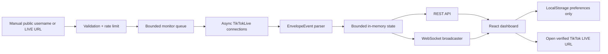

# TikTok-Chests

TikTok-Chests is an unofficial, database-free radar for Treasure Box / envelope events in **configured public TikTok LIVE streams**. It listens for genuine `EnvelopeEvent` messages, keeps temporary state in memory, and broadcasts changes to a responsive React dashboard. Users open TikTok and claim rewards manually.

> This project is not affiliated with, endorsed by, or sponsored by TikTok or ByteDance. It does not log in to TikTok, accept account cookies, claim rewards, send gifts, or create engagement.

## Feasibility status

Research performed on 16 November 2026 against [TikTokLive 7.0.1](https://pypi.org/project/TikTokLive/), its [current source](https://github.com/isaackogan/TikTokLive), [event catalog](https://ttl.docs.isaackogan.com/events/subscriptions-and-fans/#envelopeevent), and [TikTok's official developer products](https://developers.tiktok.com/docs/en/welcome) established:

- TikTokLive 7.0.1 maps `WebcastEnvelopeMessage` to `EnvelopeEvent`. Its current schema exposes `envelope_id`, `business_type`, sender metadata, `diamond_count`, `people_count`, `unpack_at`, `create_at`, `room_id`, and `super_fan_count` when TikTok includes them.
- TikTokLive is an unofficial reverse-engineered client. Public rooms do not normally require a TikTok login, but connection signing uses Euler Stream by default and is subject to its community limits. TikTok can change or regionally restrict the protocol.
- TikTok's official developer APIs do not provide a general, credential-free endpoint for discovering active LIVE rooms or subscribing to their Treasure Box events. The Research API concerns approved research access to public accounts/videos, not real-time LIVE discovery.
- TikTok's public `/live` page can be browsed anonymously and was observed listing current public rooms and viewer counts. Its listings are client-rendered, however; the static response does not provide a stable server-side feed. Historical unsigned `/webcast/feed/` approaches now return parameter/signature errors, while currently documented third-party discovery feeds require signing infrastructure, an API key, or a paid plan. The built-in discovery provider therefore truthfully reports unavailable, and validated manual username/LIVE URL monitoring remains the production fallback. There is no claim of global coverage.
- Coin-based envelope payloads are represented from `diamond_count`/`people_count`. The schema can distinguish special business types such as super-fan boxes (`business_type == 19`), but this implementation does not invent a separate “gift value” when no supported numeric reward is present.

### Live verification performed

On 16 November 2026, the scanner connected anonymously to several currently active public LIVE rooms and received genuine `RoomUserSeqEvent` traffic. A monitored room then emitted a genuine `EnvelopeEvent`, which was parsed, stored, broadcast through `/ws`, and rendered in the dashboard. The observed actionable payload contained an envelope ID, room ID, avatar URL, `diamond_count=20`, `people_count=16`, an opening timestamp, and `BUSINESS_TYPE_USER_DIAMOND`; the dashboard showed 20 coins, 16 winners, 1.25 coins per winner, 104 viewers, and the client-side countdown. No TikTok account, cookie, user token, or mock provider was used.

The probe also revealed that TikTok emits zero-valued envelope lifecycle/update messages. The parser now rejects those non-actionable messages instead of presenting them as zero-coin boxes, normalizes the business type, and retains an opened box for the configured post-opening retention period. This is a point-in-time compatibility result, not a promise that every room, region, or future TikTok protocol version will work.

On Windows, asynchronous tests and Uvicorn initially appeared to hang only inside the restricted command sandbox. A stack dump showed the Proactor loop blocked while creating its socket pair; the same `asyncio.run` probe, backend, and test suite completed normally outside that network-restricted sandbox. No application event-loop override is required for ordinary Windows development.

## Features

- Real TikTokLive `EnvelopeEvent` listener with isolated per-stream connections
- Bounded connection concurrency and queue, finite exponential reconnects, cleanup, duplicate suppression, and graceful shutdown
- Memory-only livestream, active/expired chest, scanner health, and session statistics state
- REST endpoints and resumable WebSocket snapshots/updates
- Strict public username / canonical TikTok LIVE URL validation; no arbitrary URL fetching
- Manual monitoring fallback and modular discovery-provider interface
- Honest handling of unavailable fields and an explicitly labeled heuristic opportunity score
- Sort by opportunity, coins, coins/winner, viewers, winners, opening time, or recency
- Filters, streamer search, client-side countdowns, favorites, saved preferences, and opt-in browser notifications
- Responsive dark UI, keyboard focus, semantic status states, reduced motion, and mobile layouts
- Opt-in demo provider (`CHESTS_DEMO_MODE=true`) that is never enabled or substituted automatically
- Docker backend, Vercel frontend config, and GitHub Actions CI

## Architecture



The backend deliberately has no database. Restarting it clears all server state. The browser stores only favorites, filters, sort, and notification preferences.

## Supported fields

| UI field | Source | Status |
|---|---|---|
| Streamer username | configured identifier | supported |
| LIVE URL | canonical URL built from validated username | supported |
| Room ID | connect/envelope payload | supported when present |
| Viewer count | `RoomUserSeqEvent` | supported when emitted |
| Treasure Box ID | `envelope_id` (stable hash fallback only when absent) | supported |
| Coins | `diamond_count` | supported when present |
| Winners | `people_count` | supported when present |
| Opening time | `unpack_at` | supported when present |
| Creation/detection time | `create_at` / receipt time | supported |
| Type | `business_type`; user-diamond and super-fan type 19 normalized | verified for user-diamond; other types partial |
| Display name / avatar | sender metadata when included | avatar verified; display name payload-dependent |
| Expiration time | no verified universal field | unavailable; opening drives cleanup |
| Region/country | not verified from envelope payload | unavailable |
| Participants | not verified from envelope payload | unavailable |
| Gift-based reward amount | no verified normalized amount | unavailable |

Missing values are serialized as `null` and shown as `—`; they are never fabricated. “Coins per winner” is `diamond_count / people_count`, not a guaranteed payout. The score is a 0–100 weighted heuristic over available coins, coins/winner, winners, participants (or a lower-weight viewer proxy), and time; it is not a probability.

## Local development

Prerequisites: Node.js 24+, npm 11+, and Python 3.10–3.13 (3.12 recommended).

### Backend

```powershell
cd backend
python -m venv .venv
.venv\Scripts\Activate.ps1
pip install -r requirements-dev.txt
Copy-Item .env.example .env
uvicorn app.main:app --reload --host 127.0.0.1 --port 8000
```

Open <http://localhost:8000/docs> for OpenAPI. Configure initial streams with `CHESTS_INITIAL_STREAMS=creator1,creator2`, or add them in the UI.

### Frontend

```powershell
cd frontend
npm ci
Copy-Item .env.example .env.local
npm run dev
```

Open <http://localhost:5173>. For production, set `VITE_API_URL` to the HTTPS backend and `VITE_WS_URL` to its `wss://.../ws` URL.

### Explicit demo mode

Set `CHESTS_DEMO_MODE=true` only for a local demonstration, then restart the backend. The UI shows a persistent demo banner and demo events use `source: "demo"`. Production never falls back to demo data after errors.

### Live feasibility probe

Use only a public account known to be live:

```powershell
cd backend
python scripts/feasibility_probe.py public_username 90
```

The script prints only observed connection, viewer, and safe envelope fields. A connection without an envelope during the sampling window does not prove envelopes are unsupported.

## API

- `GET /api/health` — process health, demo and no-database flags
- `GET /api/stats` — session scanner statistics
- `GET /api/chests?include_expired=false` — bounded memory state
- `GET /api/streams` — current monitors/connections
- `POST /api/streams` with `{ "value": "@creator" }` — validate and queue a public LIVE
- `DELETE /api/streams/{username}` — stop/remove a monitor
- `WS /ws` — initial `snapshot`, then `chest.created`, `chest.updated`, `chest.expired`, `stream.updated`, and `stats.updated`

Allowed HTTP and WebSocket origins come from `CHESTS_ALLOWED_ORIGINS`. Monitoring mutations use per-process IP rate limits and bounded capacity. For multi-instance deployment each instance has independent state and limits; sticky routing is recommended because there is intentionally no shared store.

## Testing

```powershell
cd backend
python -m pytest -q
python -m ruff check app tests

cd ..\frontend
npm run typecheck
npm run lint
npm test
npm run build
```

Routine CI is deterministic and never connects to TikTok. Live probing is deliberately manual.

The current fixture suite contains 17 backend tests. The verified live run is intentionally not part of CI because active rooms and envelope timing are nondeterministic.

## Docker backend

```powershell
docker build -t tiktok-chests-backend ./backend
docker run --rm -p 8000:8000 --env-file backend/.env tiktok-chests-backend
```

The image runs as a non-root user, binds `$PORT` (default 8000), and has an HTTP health check.

## Deployment

### Frontend on Vercel

1. Push this repository to GitHub and import it into Vercel.
2. The root `vercel.json` builds `frontend` and publishes `frontend/dist`. Alternatively set Root Directory to `frontend`, Build Command to `npm run build`, and Output Directory to `dist`.
3. Add `VITE_API_URL=https://your-backend.example` and `VITE_WS_URL=wss://your-backend.example/ws`.
4. Deploy. Add the final Vercel origin to backend `CHESTS_ALLOWED_ORIGINS`.

### Independent backend

Deploy `backend/Dockerfile` to a host that supports a continuously running container and WebSockets (for example Fly.io, Render, Railway, a VPS, or a container platform). Availability and free-tier policies change; verify current pricing and idle/sleep limits. Configure:

- `PORT` as required by the host
- `CHESTS_ENVIRONMENT=production`
- `CHESTS_ALLOWED_ORIGINS=https://your-frontend.vercel.app`
- concurrency, queue, retention, and request-rate settings from `backend/.env.example`
- `CHESTS_DEMO_MODE=false`

Use one worker: in-memory state and live socket ownership are process-local. Termination signals invoke scanner shutdown through FastAPI lifespan.

## Troubleshooting and limitations

- **No boxes, scanner connected:** envelopes are uncommon and not emitted in every room/region. This differs from a broken backend.
- **Offline/error immediately:** confirm the username is currently public and live. TikTok may apply regional, age, CAPTCHA, or protocol restrictions. The scanner stops finite retries and does not bypass them.
- **Signing/rate errors:** the library's default signer has community limits. Reduce configured streams. This project does not rotate proxies or evade access controls.
- **Automatic discovery unavailable:** TikTok's anonymous browser directory was verified, but it is client-rendered and is not exposed as a stable credential-free server feed. Historical unsigned feed calls no longer work, and the maintained alternatives investigated require signing or paid/API-key access. Add known public streamers manually.
- **Notifications missed in background:** browsers, especially mobile Safari/Android power-saving modes, may suspend the page. No service-worker push backend is used.
- **Restart lost state:** expected—there is no database by design.
- **License note:** project code is MIT; TikTokLive is a separate dependency under its own modified AGPL license. Review its terms for your deployment/distribution model.

Never provide TikTok passwords, session cookies, personal authentication tokens, or CAPTCHA solutions to this application.
